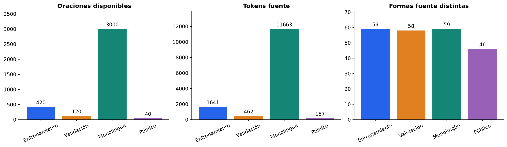
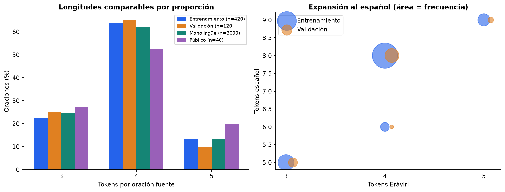
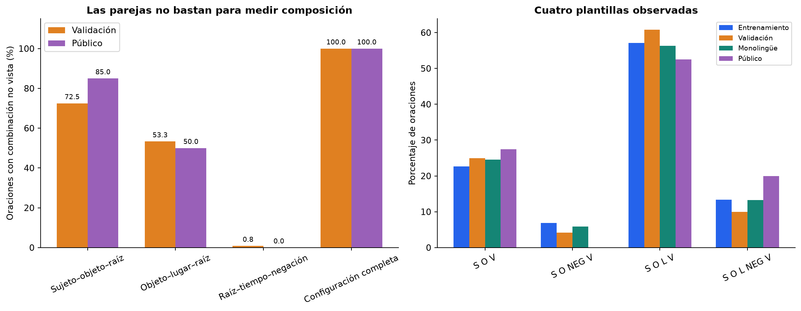
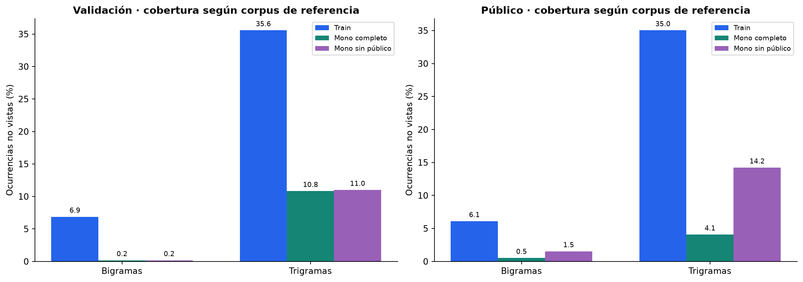
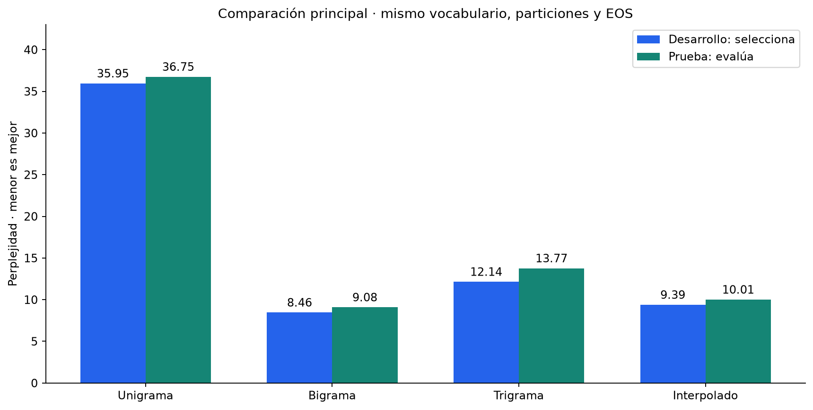
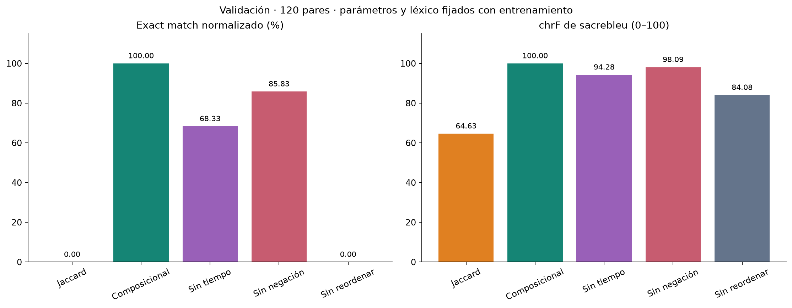
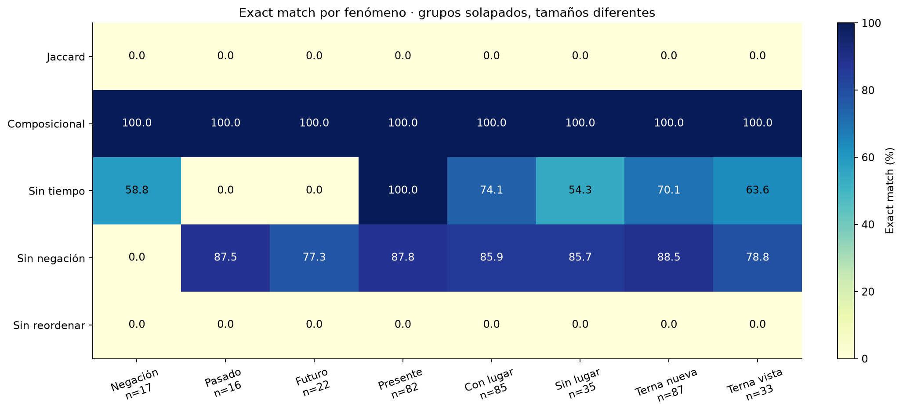

# LEXICON-X · Expedición Eráviri

## Presentación integral del proyecto: notebooks 01 al 04

**Tema:** traducción automática de pocos recursos, del idioma sintético Eráviri al español.

**Pregunta central:** ¿cómo traducir combinaciones nuevas cuando tenemos pocos ejemplos bilingües?

**Resultado observado:** el traductor composicional reproduce las 120 referencias de validación; el baseline de recuperación no obtiene coincidencias completas. Este resultado se limita a la validación disponible, ya explorada, con vocabulario conocido.

Este documento es una **presentación extendida y un guion de estudio**. Incluye contenido para mostrar, explicaciones para exponer y preguntas de defensa. No reemplaza el miniinforme de cuatro diapositivas exigido por el enunciado, disponible en [MINIINFORME.md](MINIINFORME.md).

Al final hay un recorrido de cinco minutos para seleccionar lo esencial.

---

## 01. El caso y la misión

La expedición recibe mensajes de una civilización que utiliza una lengua desconocida: **Eráviri**. Disponemos de algunas traducciones verificadas y un archivo de mensajes sin traducir.

La misión técnica consiste en construir un sistema que:

- Traduzca mensajes nuevos al español.
- Aproveche evidencia sobre vocabulario y gramática.
- Se compare con un método sencillo.
- Permita reproducir y explicar sus resultados.

El enunciado pide hipótesis, baseline, un segundo enfoque, métricas, una ablación y tres errores analizados.

**Guion oral:**

> Nuestro objetivo es investigar cómo generalizar con pocos pares bilingües. Para demostrarlo necesitamos comparar métodos y explicar qué componentes conservan el significado del mensaje.

---

## 02. El recorrido de los cuatro notebooks

| Etapa | Notebook | Pregunta que responde |
|---|---|---|
| Preparación | [01_Preprocesamiento.ipynb](01_Preprocesamiento.ipynb) | ¿Los datos están completos y cómo los representamos? |
| Exploración | [02_EDA_Corpus.ipynb](02_EDA_Corpus.ipynb) | ¿Qué regularidades y dificultades presentan? |
| Modelado estadístico | [03_Experimental.ipynb](03_Experimental.ipynb) | ¿Qué modelo estima mejor las secuencias Eráviri? |
| Traducción | [04_Traduccion.ipynb](04_Traduccion.ipynb) | ¿Podemos construir traducciones nuevas correctamente? |

```text
Datos → Preprocesamiento → Evidencia lingüística
                                  ↓
                      Modelos probabilísticos de Eráviri
                                  ↓
                    Traducción bilingüe y evaluación
```

La secuencia representa el proceso de investigación. El traductor final **no utiliza las probabilidades del LM** como componente de inferencia.

**Guion oral:**

> Primero aseguramos los datos, después estudiamos la lengua, luego medimos su predictibilidad y finalmente construimos el traductor. Cada etapa responde una pregunta distinta.

---

## 03. Los datos originales y sus funciones

| Conjunto | Oraciones | Contenido | Uso |
|---|---:|---|---|
| Entrenamiento | 420 | Eráviri y español | Aprender correspondencias |
| Validación | 120 | Eráviri y español | Evaluar y analizar errores |
| Monolingüe | 3.000 | Solo Eráviri | Estudiar secuencias y entrenar el LM |
| Público original | 40 | Solo Eráviri | Generar predicciones de entrega |

Las columnas del idioma fuente se llaman `naviri`, aunque el caso utiliza el nombre Eráviri.

Las fuentes de validación no aparecen en entrenamiento. Las del público tampoco aparecen en entrenamiento o validación.

**Guion oral:**

> Los pares bilingües nos permiten relacionar forma y significado. El corpus monolingüe aporta ejemplos de cómo se escribe Eráviri, pero no proporciona por sí solo sus traducciones españolas.

---

## 04. Notebook 01: controles de calidad

Se verifican:

- Columnas y cantidades esperadas.
- Campos no vacíos y textos con tokens.
- Identificadores únicos dentro de cada archivo.
- Fuentes repetidas y coincidencias entre conjuntos.
- Preservación de IDs, orden y texto original.

Los CSV originales permanecen intactos. Las representaciones derivadas se guardan en `resultados/preprocesamiento/`.

**Guion oral:**

> Antes de contar palabras o entrenar un sistema, comprobamos que las cifras reflejen el corpus y no errores de carga, filas vacías o duplicados. Conservamos el original para poder auditar cada transformación.

---

## 05. Notebook 01: normalización y tokenización

La normalización aplica Unicode NFC, minúsculas y espacios uniformes. La tokenización separa puntuación y conserva las palabras.

```text
Original:       "  Vonu zura miri nu lomuta.  "
Normalizado:    "vonu zura miri nu lomuta."
Tokens:        ["vonu", "zura", "miri", "nu", "lomuta"]
```

**No eliminamos stopwords, tildes, negación ni sufijos. Tampoco aplicamos stemming o lematización.**

La normalización del texto conserva puntuación. Para exact match existe otra función que elimina únicamente la puntuación final.

**Guion oral:**

> El preprocesamiento debe conservar lo que después necesitamos interpretar. Si borramos `nu`, perdemos negación. Si reducimos todas las formas verbales a una raíz, perdemos el tiempo antes de poder estudiarlo.

---

## 06. Notebook 02: tamaño, longitud y vocabulario

| Conjunto | Tokens fuente | Formas distintas | Tokens por oración, media |
|---|---:|---:|---:|
| Entrenamiento | 1.641 | 59 | 3,91 |
| Validación | 462 | 58 | 3,85 |
| Monolingüe | 11.663 | 59 | 3,89 |
| Público | 157 | 46 | 3,93 |

Las oraciones fuente tienen entre tres y cinco tokens. Todos los tokens fuente de validación, monolingüe y público ya aparecen en entrenamiento.



**Cómo leer la figura:** las barras muestran cantidades absolutas. Más oraciones no implican necesariamente más vocabulario.

**Guion oral:**

> El corpus monolingüe es mucho mayor, pero tiene las mismas 59 formas que entrenamiento. La dificultad principal de los conjuntos disponibles consiste en combinar palabras conocidas.

---

## 07. Notebook 02: expansión al español y frecuencias

Una forma Eráviri puede corresponder a varias palabras españolas:

```text
vonu → el viajero
hala → la casa, expresado como «en la casa» en la oración
```

Por eso las traducciones españolas suelen tener más tokens y no podemos alinear ambos idiomas por la misma posición de palabra.

Las frecuencias se comparan como proporciones cuando los corpus tienen tamaños diferentes. Una forma frecuente no tiene un significado demostrado solo por su frecuencia.



**Guion oral:**

> Necesitamos aprender correspondencias entre unidades y después reorganizarlas. Sustituir palabra por palabra en la misma posición no produce el español esperado.

---

## 08. Notebook 02: estructura gramatical observada

Los pares de entrenamiento respaldan esta hipótesis:

```text
Eráviri: SUJETO OBJETO [LUGAR] [nu] VERBO
Español: SUJETO [no] VERBO OBJETO [en LUGAR]
```

Los corchetes indican componentes opcionales.

| Inventario observado | Cantidad |
|---|---:|
| Sujetos | 10 |
| Objetos | 12 |
| Lugares | 6 |
| Raíces verbales | 10 |
| Formas verbales | 30 |
| Partícula `nu` | 1 |

El mapa de posiciones respalda la separación de categorías: los sujetos aparecen primero, los objetos segundos y los verbos al final.

**Guion oral:**

> Formulamos una gramática explícita a partir de evidencia del entrenamiento. El sistema aprende el vocabulario dentro de esa hipótesis; no afirmamos que descubra automáticamente la gramática de cualquier lengua.

---

## 09. Notebook 02: ejemplo lingüístico completo

```text
vonu       zura       miri          nu       lomuta
el viajero la llave   en el bosque  no       buscó
```

La interpretación estructurada es:

```python
{
    "subject": "vonu",
    "object": "zura",
    "location": "miri",
    "negative": True,
    "root": "lomu",
    "tense": "pasado"
}
```

La generación española produce:

> **El viajero no buscó la llave en el bosque.**

Este ejemplo pertenece al entrenamiento y sirve para explicar el mecanismo. La generalización se mide con los ejemplos de validación.

---

## 10. Notebook 02: morfología y una corrección importante

| Forma | Traducción observada | Tiempo |
|---|---|---|
| `lomu` | busca | Presente |
| `lomuta` | buscó | Pasado |
| `lomuri` | buscará | Futuro |

Los sufijos observados son `-ta` para pasado y `-ri` para futuro, pero deben reconocerse respecto a una raíz conocida.

```text
kori   → guarda       presente
korita → guardó       pasado
koriri → guardará     futuro
```

Contar como futuro cualquier palabra terminada en `ri` clasificaba mal `kori`. El conteo corregido de validación es **22 futuros**, no 28.

**Guion oral:**

> Una terminación gráfica no basta para identificar un morfema. Comprobamos que exista la raíz correspondiente y contrastamos la interpretación con las traducciones de entrenamiento.

---

## 11. Notebook 02: qué significa generalizar

Conocer las palabras por separado no implica haber visto juntas a las personas, objetos y acciones.

Definimos **terna nueva** como una combinación sujeto–objeto–raíz verbal ausente de entrenamiento.

| Combinación no observada en entrenamiento | Validación | Público |
|---|---:|---:|
| Sujeto–objeto | 4/120 | 0/40 |
| Sujeto–objeto–raíz | **87/120** | **34/40** |
| Configuración completa | 120/120 | 40/40 |



**Guion oral:**

> Si solo miramos parejas, el conjunto puede parecer sencillo. Al estudiar ternas, encontramos que el 72,5 % de validación exige combinar participantes y acciones de una manera que no aparece en entrenamiento.

No denominamos a esto vocabulario desconocido. Tampoco la ausencia de una oración demuestra por sí sola un cambio de distribución.

---

## 12. Notebook 02: aporte y coincidencias del monolingüe

El monolingüe aporta contextos nuevos, aunque no formas nuevas. En validación, el 35,57 % de las ocurrencias de trigramas no está en entrenamiento; usando el monolingüe completo como referencia, esa proporción baja al 10,82 %.

Además, **28 de los 40 mensajes públicos aparecen en el monolingüe**, sin traducción española.

Se distinguen dos condiciones:

- **Sin exposición pública exacta:** quedan 2.972 oraciones monolingües.
- **Transductiva:** se permite ver esas fuentes públicas sin etiquetas.



**Guion oral:**

> Ver una entrada sin su traducción no equivale a disponer de su respuesta, pero afecta las medidas de familiaridad. Por eso declaramos la coincidencia y separamos las condiciones experimentales.

La cobertura de n-gramas del EDA no es una medida de exactitud de traducción ni el resultado de un LM ya entrenado.

---

## 13. Notebook 03: analizar los archivos nuevos

| Archivo de fase 5 | Filas | Tratamiento |
|---|---:|---|
| Pistas léxicas | 21 | Contrastar correspondencias |
| Comunicación inicial de Noelia | 18 | Dominio conversacional separado |
| Nuevos mensajes | 40 | Fuentes sin traducción de referencia |

Las 21 pistas son consistentes con entrenamiento. Los guiones de `-ta` y `-ri` se conservan como información de sufijo: no son palabras independientes.

Los cuarenta mensajes nuevos no coinciden con los conjuntos anteriores y utilizan vocabulario conocido. Contienen 16 negaciones, 13 pasados, 13 futuros y 20 lugares explícitos; los fenómenos se solapan.

Las expresiones conversacionales introducen **15 formas nuevas**. De sus 26 ocurrencias léxicas, 25 son desconocidas para el LM principal.

**Guion oral:**

> Los archivos nuevos cumplen funciones distintas. Una pista léxica no es una oración adicional y un saludo no necesariamente sigue la estructura declarativa del corpus original. Mantener esos roles separados evita conclusiones engañosas.

---

## 14. Notebook 03: modelo de lenguaje frente a traducción

| Componente | Pregunta |
|---|---|
| Modelo de lenguaje Eráviri | ¿Qué probabilidad tiene esta secuencia en Eráviri? |
| Traductor bilingüe | ¿Qué oración española corresponde a este mensaje? |

El modelo de lenguaje estima probabilidades a partir de secuencias. Necesitamos los pares bilingües para establecer las correspondencias con el español.

Ejemplo de contexto:

```text
vonu zura miri nu lomuta

Unigramas: vonu, zura, miri, nu, lomuta
Bigramas: vonu zura, zura miri, miri nu, nu lomuta
Trigramas: vonu zura miri, zura miri nu, miri nu lomuta
```

**Guion oral:**

> El modelo estadístico aprende regularidades de aparición. La traducción necesita además mantener el significado al pasar a otro idioma. Son dos problemas relacionados, con métricas diferentes.

---

## 15. Notebook 03: modelos y suavizado

Se comparan:

- Unigrama: `P(palabra)`.
- Bigrama: `P(palabra | anterior)`.
- Trigrama: `P(palabra | dos anteriores)`.
- Interpolado: combinación de las tres probabilidades.

El suavizado aditivo evita probabilidades cero:

```text
P(palabra | contexto) =
    (conteo(contexto, palabra) + alpha)
    / (conteo(contexto) + alpha × vocabulario_de_predicción)
```

Se usan fronteras `<s>` y `</s>`. No se cuentan contextos que crucen entre oraciones. `<unk>` representa palabras fuera del vocabulario de entrenamiento.

**Guion oral:**

> Una secuencia no observada puede ser válida. El suavizado reserva probabilidad para esos casos. Un alpha demasiado grande vuelve las predicciones más uniformes; uno demasiado pequeño puede penalizar mucho contextos nuevos.

---

## 16. Notebook 03: separación y selección experimental

Después de excluir las 28 fuentes públicas exactas, se divide el monolingüe con semilla `20261014`:

| Partición del LM | Oraciones | Función |
|---|---:|---|
| Entrenamiento | 2.377 | Ajustar vocabulario y conteos |
| Desarrollo | 297 | Elegir parámetros y modelo |
| Prueba | 298 | Evaluar el modelo elegido |

El vocabulario se obtiene exclusivamente de entrenamiento: 59 formas más `<unk>` y `</s>` como predicciones. `<s>` solo funciona como contexto.

Se prueban cinco valores de alpha y tres alternativas de pesos de interpolación. Son **150 configuraciones** en cinco condiciones de corpus.

**Guion oral:**

> Desarrollo elige el modelo; prueba informa su desempeño reservado. Mantener separados esos papeles evita seleccionar una configuración solo porque funcionó mejor en la prueba.

---

## 17. Notebook 03: resultados de los modelos de lenguaje

La perplejidad resume la sorpresa media del modelo sobre los tokens evaluados. Con la misma tokenización, vocabulario y tratamiento de fronteras, **menor es mejor**.

| Familia en mono limpio | Desarrollo | Prueba |
|---|---:|---:|
| Unigrama | 35,95 | 36,75 |
| **Bigrama** | **8,46** | **9,08** |
| Trigrama | 12,14 | 13,77 |
| Interpolado | 9,39 | 10,00 |



**Decisión:** bigrama con suavizado aditivo y alpha 0,01, elegido por desarrollo.

**Guion oral:**

> El orden local mejora mucho frente a contar palabras aisladas. El trigrama tiene más contexto, pero también más situaciones que estimar. En esta comparación no supera al bigrama; más complejidad no aseguró mejor resultado.

La perplejidad 9,08 no es 9,08 % de error ni una precisión de traducción.

---

## 18. Notebook 03: controles y cambio de dominio

Con bigrama y alpha 0,01 fijos:

| Corpus de entrenamiento | Perplejidad de prueba |
|---|---:|
| 420 fuentes bilingües | 13,70 |
| 2.377 fuentes monolingües limpias | 9,08 |
| Muestra monolingüe de 420 | 12,17 |

La muestra de 420 permite observar que el volumen de datos es parte de la explicación. Se utiliza una sola muestra: no presentamos diferencias pequeñas como estadísticamente significativas.

El modelo congelado obtiene 10,54 de perplejidad en fase 5 y 2.050,19 en conversación. Esta última tiene **96,15 % de OOV** y otra estructura; no constituye una comparación justa de calidad de traducción.

**Guion oral:**

> El monolingüe ayuda a estimar secuencias. Los saludos son otro dominio, con palabras casi completamente desconocidas para este LM. Sus resultados nos dicen dónde falta cobertura, no qué traducción sería correcta.

---

## 19. Notebook 04: hipótesis principal de traducción

> **Separar vocabulario y estructura permite traducir combinaciones nuevas mejor que recuperar traducciones completas por similitud.**

La comparación utiliza los mismos 420 pares para aprender y las mismas 120 referencias para evaluar.

| Sistema | Mecanismo |
|---|---|
| Baseline Jaccard | Encuentra una fuente parecida y copia su traducción |
| Composicional | Interpreta componentes y construye el español |

Las reglas se fijan a partir de la hipótesis lingüística y el léxico se induce de entrenamiento. Las pistas oficiales se contrastan, pero no se utilizan para ajustar el léxico de esta comparación.

**Guion oral:**

> La diferencia experimental es copiar una frase completa frente a construir una frase a partir de componentes. No añadimos correcciones particulares para cada oración de validación.

---

## 20. Notebook 04: funcionamiento de Jaccard

```text
Jaccard = palabras compartidas / palabras distintas entre las dos fuentes
```

Los textos se representan como conjuntos, así que se pierde el orden. En un empate se escoge el primer ejemplo de entrenamiento.

Caso real:

```text
Fuente:       telu tavi nemi.
Referencia:   el maestro recuerda el alimento.
Jaccard:      el maestro recuerda la carta.
```

La traducción es fluida y parcialmente parecida, pero cambia el objeto. El método no reemplaza automáticamente las partes distintas de la frase recuperada.

**Guion oral:**

> El baseline es útil porque establece cuánto obtenemos con una recuperación sencilla. Reconocer varias palabras compartidas no basta para conservar todos los participantes y la acción del mensaje.

---

## 21. Notebook 04: funcionamiento del composicional

```text
Entrada Eráviri
      ↓
Tokenización conservadora
      ↓
Análisis de sujeto, objeto, lugar, negación y verbo
      ↓
Consulta del léxico aprendido
      ↓
Generación: sujeto + [no] + verbo + objeto + [en lugar]
```

Las correspondencias ambiguas detienen el entrenamiento para revisión. Las fuentes fuera de cobertura producen `UnsupportedSentence`.

Las conjugaciones españolas se consultan como formas completas aprendidas. El sistema no es un conjugador general de verbos desconocidos.

**Guion oral:**

> El sistema conserva las piezas de la entrada y cambia su organización para generar español. Si una palabra o estructura no está respaldada por entrenamiento, declara falta de cobertura en lugar de inventar una traducción.

---

## 22. Notebook 04: métricas de traducción

| Métrica | Qué mide | Escala |
|---|---|---|
| Exact match normalizado | Coincidencia de toda la oración | 0–1; se presenta en % |
| chrF | Semejanza de grupos de caracteres | 0–100 |

Ambas reciben cadenas normalizadas con NFC, minúsculas, espacios uniformes y sin puntuación final. Se conservan tildes y puntuación interna.

chrF usa sacrebleu 2.6.0, orden de caracteres 6, beta 2, sin n-gramas de palabras y sin contar espacios. Su firma queda registrada.

**Guion oral:**

> Exact match exige coincidencia completa. chrF reconoce semejanza parcial. Necesitamos ambas porque una frase casi idéntica en caracteres puede perder una negación y comunicar lo contrario.

---

## 23. Notebook 04: resultado principal

| Sistema | Aciertos | Exact match | chrF |
|---|---:|---:|---:|
| Jaccard | 0/120 | 0,00 % | 64,63 |
| **Composicional** | **120/120** | **100,00 %** | **100,00** |
| Sin tiempo verbal | 82/120 | 68,33 % | 94,28 |
| Sin negación | 103/120 | 85,83 % | 98,09 |
| Sin reordenamiento | 0/120 | 0,00 % | 84,08 |



**Guion oral:**

> La composición supera a la recuperación en los 120 ejemplos disponibles. El baseline conserva semejanza parcial, pero no reproduce ninguna referencia completa. El sistema propuesto conserva los componentes y su estructura.

El 100 % corresponde a esta validación, ya explorada y con vocabulario conocido; no garantiza el test oculto.

---

## 24. Notebook 04: evaluación por fenómeno

| Grupo | Aciertos del composicional |
|---|---:|
| Negación | 17/17 |
| Pasado | 16/16 |
| Futuro | 22/22 |
| Presente | 82/82 |
| Con lugar | 85/85 |
| Sin lugar | 35/35 |
| Terna nueva | **87/87** |
| Terna vista | 33/33 |



**Guion oral:**

> El resultado no depende solo de frases afirmativas en presente. También comprobamos negación, tiempos y lugares. La evaluación de ternas nuevas muestra composición de elementos conocidos.

Los grupos se solapan. Las 87 ternas nuevas no son 87 palabras nuevas ni una prueba de conjugaciones desconocidas.

---

## 25. Notebook 04: por qué hacemos ablaciones

Una ablación desactiva un componente manteniendo los demás iguales.

Para `vonu zura miri nu lomuta.`:

| Variante | Salida |
|---|---|
| Completa | el viajero no buscó la llave en el bosque. |
| Sin tiempo | el viajero no busca la llave en el bosque. |
| Sin negación | el viajero buscó la llave en el bosque. |
| Sin reordenar | el viajero la llave en el bosque no buscó. |

Sin tiempo fallan los 38 pasados/futuros; sin negación fallan las 17 negativas. Sin reordenamiento dejan de coincidir las 120 referencias.

**Guion oral:**

> Las ablaciones muestran qué aporta cada componente. La variante sin tiempo conserva el análisis de entrada, pero genera presente. No es una prueba de aprendizaje de verbos nuevos. La variante sin negación obtiene 98,09 de chrF y aun así falla en todas las negativas.

---

## 26. Notebook 04: tres errores reales del baseline

| Fuente | Referencia | Predicción Jaccard | Error |
|---|---|---|---|
| `telu tavi nemi.` | el maestro recuerda el alimento. | el maestro recuerda la carta. | Objeto |
| `vonu suni rilo kori.` | el viajero guarda el libro en el río. | el viajero elige el libro en el río. | Acción |
| `naku kava kuna nu vasi.` | el niño no comparte la carta en el mercado. | el niño comparte el mapa en el mercado. | Objeto y negación |

**Guion oral:**

> El modelo completo no tiene errores observados en esta validación, así que no inventamos fallos para él. Analizamos los del baseline y las ablaciones, indicando siempre qué sistema produjo cada error.

La taxonomía automática compara componentes del español controlado; no se presenta como una métrica semántica universal.

---

## 27. Qué aportó realmente el notebook 03 al traductor

El LM fuente estudia `P(mensaje Eráviri)`. Para una misma fuente, esa probabilidad no cambia entre candidatos españoles.

El traductor composicional actual:

- Aprende el léxico de los 420 pares.
- No utiliza los conteos monolingües.
- No utiliza el bigrama para seleccionar traducciones.
- No necesita leer el modelo del 03 para funcionar.

**Guion oral:**

> El LM aportó investigación y una mejora medida de predicción de secuencias Eráviri. No le atribuimos una mejora de traducción que no hemos probado. Integrar modelos es útil cuando existe un mecanismo concreto y una evaluación de su aporte.

---

## 28. Expresiones oficiales y entradas no cubiertas

Un enrutador separado trata expresiones publicadas por Noelia:

```text
salia neri → Buenos días
noku       → No
nelo mali  → Un mensaje, por favor
pali       → Disculpa / Perdón
```

La ruta se registra como `official_phrase_memory`; una oración generada usa `compositional`.

Se conserva el signo de pregunta en la búsqueda: `seni?` es una expresión conocida y `seni` no se equipara automáticamente a ella.

**Guion oral:**

> Conocer dieciocho expresiones oficiales no demuestra generalización conversacional. Por eso separamos su memoria de la evaluación principal y conservamos las alternativas que proporciona el archivo original.

---

## 29. Entregables y trazabilidad

| Archivo | Contenido |
|---|---|
| [predicciones.csv](predicciones.csv) | 40 mensajes del público original, columnas `id,prediccion` |
| [predicciones_fase5.csv](predicciones_fase5.csv) | 40 mensajes de fase 5, separados |
| [MINIINFORME.md](MINIINFORME.md) | Resumen de cuatro diapositivas |
| [REGISTRO_HERRAMIENTAS.md](REGISTRO_HERRAMIENTAS.md) | Bibliotecas, IA y limitaciones |
| `resultados/traduccion_04/` | Métricas, errores, trazas, gráficos y traductor JSON |

Se verifican encabezados, cantidad de filas, IDs únicos, predicciones no vacías y orden contra cada archivo fuente. El público conserva IDs `NX-...` y fase 5, `F5-...`.

**Guion oral:**

> Las predicciones son trazables: podemos consultar qué componentes identificó el sistema. Como público y fase 5 no tienen referencias españolas disponibles, no afirmamos una exactitud verificada para esos archivos.

---

## 30. Reproducibilidad y herramientas

- Python de referencia: 3.14.3, Windows.
- Matplotlib de referencia: 3.11.2.
- sacrebleu de referencia: 2.6.0.
- Semilla del LM: `20261014`; traductor determinista.
- Modelos guardados en JSON, con vocabulario y conteos.
- Versiones, firmas de métricas y hashes de los CSV registrados.
- **20 pruebas automatizadas verificadas** en la ejecución del notebook 04.

Las pruebas cubren probabilidades, fronteras, OOV, particiones, conflictos léxicos, tiempos, negación, expresiones, guardado/carga y contrato de exportación.

**Guion oral:**

> Los números se calcularon ejecutando el código local. Se declaró la asistencia de Codex/ChatGPT en análisis, implementación y documentación. No utilizamos modelos preentrenados de traducción ni archivos privados del docente.

---

## 31. Limitaciones y siguiente investigación

1. La lengua es sintética y tiene una gramática controlada.
2. La validación fue explorada durante el desarrollo.
3. No hay vocabulario nuevo en los conjuntos declarativos disponibles.
4. Las treinta formas verbales ya aparecen en entrenamiento.
5. El sistema rechaza estructuras y palabras no cubiertas.
6. Los saludos son ejemplos conocidos, no un benchmark independiente.
7. La evaluación oficial oculta está pendiente.

Con más tiempo estudiaríamos composiciones más difíciles, palabras y formas verbales retenidas deliberadamente, estructuras nuevas y una evaluación independiente. Compararíamos enfoques adicionales contra el sistema actual.

**Guion oral:**

> El resultado muestra que la estructura importa cuando hay pocos pares y una lengua regular. No demuestra dominio general de Eráviri ni permite extrapolar a lenguas indígenas reales. El siguiente paso científico es evaluar condiciones que todavía no hemos cubierto.

---

## 32. Cierre propuesto para la exposición

> Organizamos el trabajo en cuatro etapas: preparación de datos, análisis lingüístico, modelado estadístico y traducción. Encontramos que el vocabulario disponible está cubierto, pero muchas combinaciones son nuevas. El bigrama suavizado fue el mejor modelo de lenguaje en nuestro experimento. Para traducir, separar vocabulario y estructura permitió reproducir las 120 referencias de validación, mientras la recuperación Jaccard no obtuvo coincidencias completas. Las ablaciones mostraron el aporte del tiempo, la negación y el orden. La conclusión se limita a los datos sintéticos conocidos y debe contrastarse con la evaluación oficial oculta.

---

## Preguntas de defensa y respuestas sugeridas

### ¿Por qué no empezar por un Transformer?

Porque solo contamos con 420 pares y observamos una estructura muy regular. Empezamos con métodos que podemos comparar e interpretar claramente. Un Transformer podría ser otra comparación, pero el enunciado no lo exige y su complejidad no garantiza mejor generalización.

### ¿Entonces el traductor es un modelo estadístico?

El notebook 03 sí implementa modelos estadísticos de lenguaje. El traductor del 04 es composicional, con reglas explícitas y correspondencias léxicas extraídas mediante conteos de entrenamiento. No es un decoder probabilístico completo ni una red neuronal.

### ¿Qué evidencia sostiene el orden de palabras?

Las posiciones de las formas y los pares bilingües de entrenamiento son compatibles con `S O [L] [nu] V`. La hipótesis cubre las 420 fuentes de entrenamiento y también las fuentes declarativas disponibles. Esa cobertura mide compatibilidad estructural, no exactitud de traducción por sí sola.

### ¿No estamos memorizando traducciones?

Aprendemos correspondencias léxicas y conjugaciones completas conocidas. La generación combina componentes sin guardar excepciones de validación. Los 87 aciertos sobre ternas nuevas respaldan composición dentro del vocabulario observado. Las dieciocho expresiones conversacionales sí son memoria explícita y se declaran por separado.

### ¿Cómo explican el 100 %?

El corpus es sintético y regular, las palabras y las treinta conjugaciones están cubiertas por entrenamiento y la plantilla modela bien las referencias. Es 100 % en los 120 pares de validación disponibles, no una garantía para cualquier entrada. Además, esa validación ya fue explorada.

### ¿Qué aportó el monolingüe?

Permitió estudiar posiciones, frecuencias y contextos. Con un bigrama y alpha fijos, la perplejidad de prueba bajó de 13,70 usando solo las 420 fuentes a 9,08 con mono limpio. El control de 420 ejemplos monolingües dio 12,17, señalando el tamaño como factor. El traductor final no usa esos conteos, por lo que no le atribuimos una mejora de traducción al monolingüe.

### ¿Qué hicieron con las coincidencias público–monolingüe?

Las identificamos y declaramos. Excluimos las 28 fuentes exactas para el protocolo principal del LM y mantuvimos una condición transductiva separada. No había etiquetas españolas en esas coincidencias. Los CSV originales no se modificaron.

### ¿Cómo evitaron fuga y sobreajuste a validación?

El léxico del traductor se ajusta solo con entrenamiento. El LM ajusta vocabulario y conteos solo con su partición de entrenamiento y elige parámetros con desarrollo. No añadimos traducciones particulares de validación al sistema. Sin embargo, declaramos que validación se exploró en el EDA y necesitamos el test oculto para una evaluación independiente.

### ¿Por qué usar exact match y chrF juntos?

Exact match exige igualdad completa; chrF muestra semejanza parcial. La ablación sin negación obtiene 98,09 de chrF, pero falla en las diecisiete negativas. Ese ejemplo demuestra por qué una sola medida superficial no basta.

### ¿El LM podría escoger la mejor traducción española?

El LM que entrenamos es de Eráviri. La probabilidad de la fuente es igual para todos los candidatos españoles de esa fuente. Un LM español podría evaluar fluidez de candidatos, pero no garantizar conservación del significado; su utilidad tendría que comprobarse experimentalmente.

### ¿Qué ocurre con una palabra desconocida?

En el LM se representa con `<unk>` y se informa su tasa de OOV. En el traductor, una palabra o estructura fuera de cobertura provoca una excepción explícita. Son políticas distintas porque modelar probabilidad y traducir significado requieren decisiones diferentes.

### ¿Las pistas cambiaron el resultado del traductor?

No se utilizaron para ajustar el léxico del experimento. Las veintiuna fueron consistentes con correspondencias ya presentes en entrenamiento y sirvieron como contraste oficial. No afirmamos una mejora causal por disponer de ellas.

### ¿Los cuarenta mensajes de fase 5 son correctos al 100 %?

No tenemos referencias para medirlo. El sistema puede analizar y generar una salida para los cuarenta, pero cobertura no significa precisión verificada. Las predicciones se entregan separadas del público original.

### ¿Qué experimento harían con una semana adicional?

Crearíamos una partición que reserve vocabulario, conjugaciones o estructuras y estudiaríamos si el sistema puede generalizar más allá de las combinaciones ya cubiertas. Añadiríamos evaluación independiente y comparaciones adicionales, manteniendo el protocolo de métricas y ablaciones.

---

## Recorrido recomendado para una defensa de cinco minutos

| Tiempo | Contenido | Secciones de apoyo |
|---|---|---|
| 0:00–0:35 | Problema, pregunta y datos | 01–03 |
| 0:35–1:15 | Preprocesamiento y hallazgo lingüístico | 05, 08–11 |
| 1:15–2:00 | LM, división y elección del bigrama | 14–17 |
| 2:00–3:05 | Baseline, composicional y resultados | 19–23 |
| 3:05–4:10 | Ternas nuevas, ablaciones y errores | 24–26 |
| 4:10–5:00 | Entregables, límites y conclusión | 29–32 |

No es necesario mostrar las 32 secciones en cinco minutos. Utilizar el [miniinforme de cuatro diapositivas](MINIINFORME.md) para la defensa breve y este documento para estudiar o responder preguntas.

Si participan tres integrantes, pueden distribuir preparación/EDA, modelos estadísticos y traducción/evaluación. Todos deben comprender el sistema completo, como exige el enunciado.

---

## Glosario para explicar sin tecnicismos innecesarios

| Término | Explicación |
|---|---|
| Corpus | Colección de textos u oraciones |
| Token | Unidad de texto; aquí, normalmente una palabra |
| Vocabulario | Conjunto de formas distintas, no el total de apariciones |
| EDA | Exploración de los datos antes de decidir cómo modelarlos |
| Baseline | Método sencillo que sirve como referencia de comparación |
| LM | Modelo de lenguaje: asigna probabilidades a secuencias |
| Bigrama / trigrama | Grupo de dos / tres tokens consecutivos |
| Suavizado | Reserva probabilidad para eventos no observados |
| Perplejidad | Medida de sorpresa media del LM; menor es mejor bajo condiciones comparables |
| OOV | Token fuera del vocabulario ajustado en entrenamiento |
| Composicional | Construye la oración combinando componentes interpretados |
| Ablación | Desactiva un componente para medir su contribución |
| Exact match | Proporción de traducciones completas iguales a su referencia normalizada |
| chrF | Semejanza de grupos de caracteres; no garantiza equivalencia de significado |
| Transductivo | Utiliza entradas de evaluación sin sus etiquetas durante el aprendizaje |
| Fuga de datos | Uso indebido de información reservada que vuelve engañosa la evaluación |

---

## Evidencia y material para consultar

- [Enunciado y criterios de evaluación](ENUNCIADO.md).
- [Análisis e interpretación del EDA](EDA_CORPUS.md).
- [Protocolo y resultados de modelos estadísticos](EXPERIMENTOS_03.md).
- [Informe técnico de traducción](TRADUCCION_04.md).
- [Métricas del LM](resultados/experimental_03/metricas.json).
- [Métricas de traducción](resultados/traduccion_04/metricas.json).
- [Detalle de las 600 predicciones de validación](resultados/traduccion_04/validacion_detalle.csv).
- [Errores de baseline y ablaciones](resultados/traduccion_04/errores.csv).
- [Registro de herramientas, IA y limitaciones](REGISTRO_HERRAMIENTAS.md).

Las cifras corresponden a las ejecuciones guardadas del proyecto. Si cambian los datos o el código, se deben regenerar los experimentos y actualizar esta presentación antes de exponerla.
